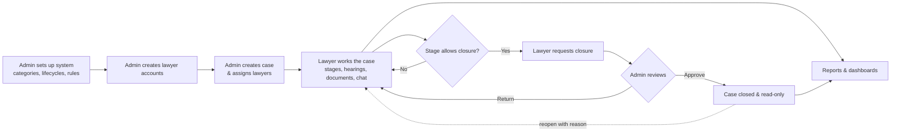
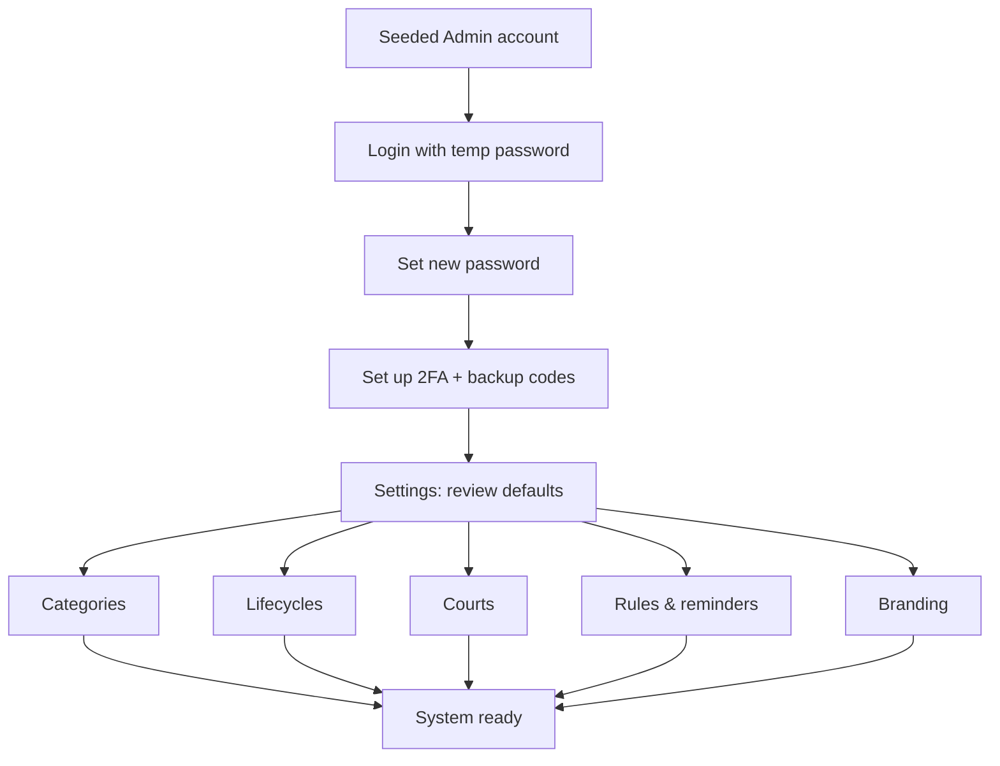
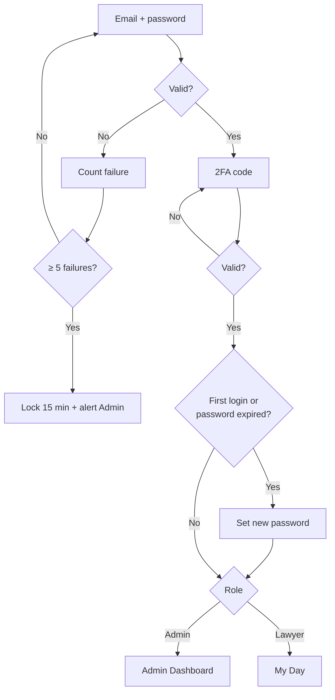
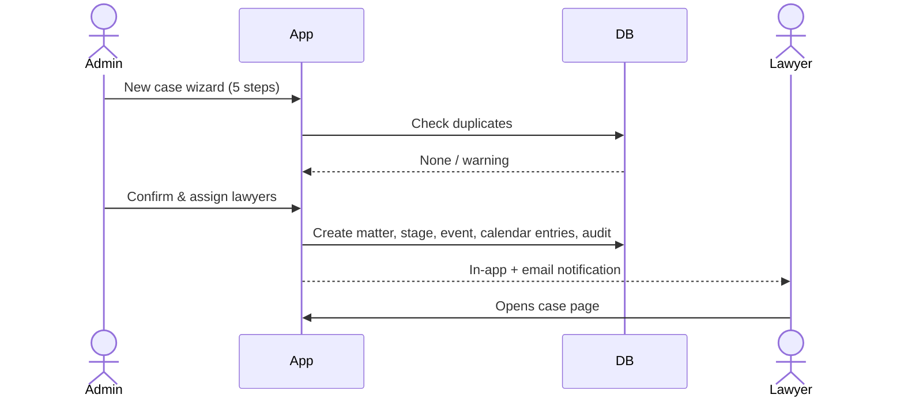
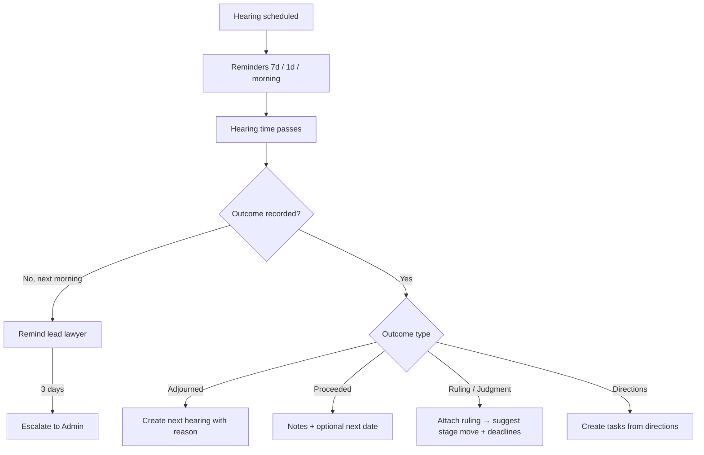
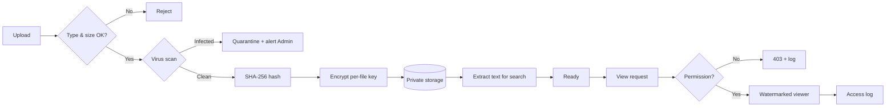
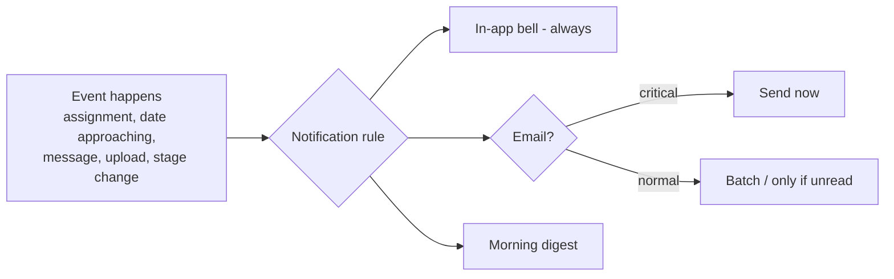
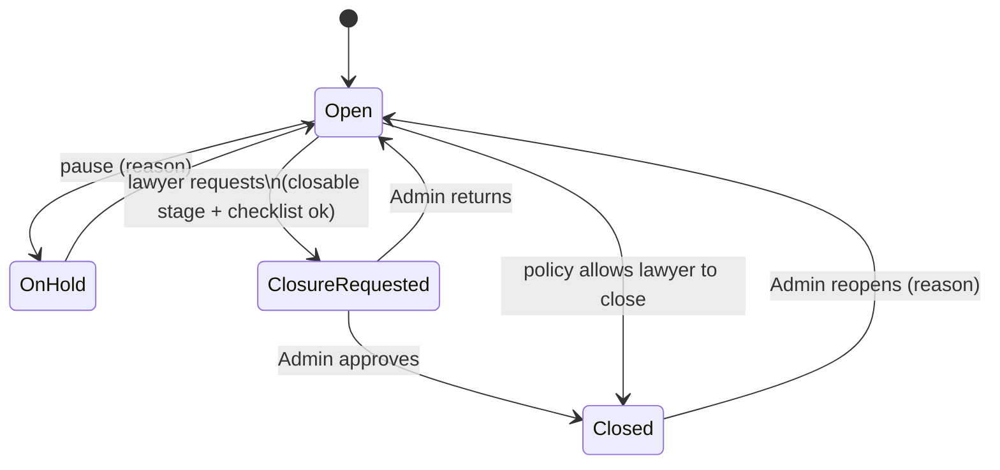
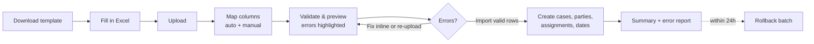

# CAA Legal — Full System Flows
Companion to `PROJECT_SPEC.md`. Every journey through the system, step by step, with diagrams (Mermaid — renders on GitHub, VS Code, and most markdown viewers).

**Legend used in steps:** 🟦 Admin action · 🟩 Lawyer action · ⚙️ System does it automatically · 🔔 Notification sent · 📝 Audit log entry

---

## 0. The big picture



**Site map**

```
Admin                                   Lawyer
├── Dashboard                           ├── My Day (dashboard)
├── Cases (all) ─ Case page             ├── My cases ─ Case page
├── Calendar (department)               ├── My calendar
├── Closure requests                    └── Tasks
├── Users
├── Reports                             Top bar (both): search · bell (notifications + @mentions)
├── Import                              User card (both): Profile & preferences (theme, digest, mutes)
└── Settings                            Chat lives inside each case — no global Messages page
    ├── Categories
    ├── Matter types & lifecycles
    ├── Courts & forums
    ├── Outcomes / event & document types
    ├── Deadline rules & reminders
    ├── Security
    ├── Branding
    └── AI assistant
```

---

## 1. First-time system setup (Admin)

1. ⚙️ Installation seeds one Admin account + all defaults (categories, lifecycles, courts, outcomes, reminder rules).
2. 🟦 Admin logs in with the temporary password → forced to set a new password → sets up 2FA (scans QR code in an authenticator app, confirms a code, downloads backup codes).
3. 🟦 Admin opens **Settings** and reviews defaults: renames / adds / deactivates categories, edits lifecycle stages, adds courts, sets closure policy and reminder schedules.
4. 🟦 Uploads UCAA logo, sets login page text.
5. 📝 Every setting change is logged with before/after values.



---

## 2. Login (everyone)

1. Enter email + password.
2. ⚙️ Checks: account active? locked? password correct? → after 5 failures (configurable) account locks for 15 min, 🔔 Admin alerted.
3. Enter 2FA code (or backup code).
4. ⚙️ If first login or password expired → forced password change.
5. Land on dashboard (Admin → Admin Dashboard, Lawyer → My Day).
6. ⚙️ Idle 15 min → screen locks, re-enter password to continue (unsaved form data kept).

**Forgot password:** enter email → ⚙️ always shows "If this email exists, a link was sent" (never reveals which emails exist) → link valid 30 min, single use → set new password → all other sessions signed out → 🔔 email "your password was changed".



---

## 3. Onboarding a lawyer (Admin)

1. 🟦 Users → **Add lawyer**: name, email, phone, title, practising certificate no. + expiry.
2. ⚙️ Account created with a one-time invite link (valid 72 h). 🔔 Email to the lawyer. 📝
3. 🟩 Lawyer opens link → sets password → sets up 2FA → lands on an empty My Day with a short 3-step welcome ("Your cases will appear here", "Your calendar fills automatically", "Turn on email digests").
4. Invite expired? 🟦 Admin clicks **Resend invite**.

**Offboarding:** 🟦 Users → lawyer → **Deactivate** → system shows their open cases → Admin reassigns them (all to one person or one by one) → ⚙️ sessions revoked, account disabled, history kept, 🔔 new lead lawyers notified. 📝

---

## 4. Creating & assigning a case (Admin)

1. 🟦 **+ New case** (top bar) → 5-step wizard with progress bar, draft auto-saved:
   1. **Basics** — title, category/sub-category, matter type (this picks the lifecycle), UCAA's role, priority, confidentiality.
   2. **Forum** — court/tribunal, division, location, case number, ECCMIS number, judge. (Skippable for advisory matters.)
   3. **Parties** — opposing parties & counsel, witnesses, internal UCAA contact.
   4. **Facts & value** — description, amount claimed/against, cause-of-action date, referral memo.
   5. **Assign & start** — lead lawyer (dropdown shows each lawyer's current workload + next free day), supporting lawyers, starting stage, first deadline/hearing, initial documents.
2. ⚙️ Duplicate check: warns if a case with the same court number or same parties exists.
3. ⚙️ Generates reference (e.g. `UCAA/LIT/2026/0042`, pattern set in Settings), creates first timeline event "Case opened", places dates on assigned lawyers' calendars. 📝
4. 🔔 Assigned lawyers: "You've been assigned *UCAA v. XYZ Aviation Ltd* as Lead Counsel."



**Reassignment:** case page → ⋯ → **Reassign** → pick new lead / add or remove supporting → reason (optional) → ⚙️ calendars updated, timeline event added, 🔔 old and new lawyers notified. 📝

---

## 5. A lawyer's day ("My Day")

1. 🟩 Logs in → **My Day** shows, in order:
   - 🔴 Overdue items (always pinned on top)
   - Today: hearings (time, court, courtroom, purpose) and deadlines
   - "Record outcome" cards for yesterday's hearings not yet updated
   - This week (compact list)
   - My cases (stage chip + next date), unread messages & mentions
   - (Later, v2) ✨ "Your week at a glance" AI briefing
2. 🟩 Clicks any item → goes straight to the right case tab (e.g. hearing → Hearings tab with that hearing open).
3. ⚙️ Optional 7:00 AM email digest with the same "today" list.

---

## 6. Working a case — the Case Page

**Opening a case — what the lawyer sees in the first 30 seconds:**
(Visual reference: `docs/design/case-page.html`.)
1. Header: title, reference, court no., ECCMIS no., court, status, priority, confidentiality lock chip, team avatars; buttons Add event · Upload · **Move stage** · ⋯ (Schedule hearing, Add deadline, New application, Reassign, Put on hold, Request closure).
2. Lifecycle tracker: where the case is now, "Stage X of Y · N days open"; click a stage → dates + key events in it; sub-processes as branches underneath.
3. "Case in 30 seconds": summary (What it's about · Where it stands · What's next) + pinned messages. Right column: Key facts (next date & purpose, amount, UCAA role, judge, opposing counsel, category, last activity) · Deadlines · Team.
4. Tabs: Timeline · Documents · Hearings & deadlines · Tasks · Discussion · Parties · Notes · Activity.

**Everyday actions (all logged 📝, all update "last activity"):**

| Action | Steps | Automatic effects |
|---|---|---|
| **Add event** | + Add event → type (filing, correspondence, ruling, …) → date, description, attach documents | Added to timeline; ⚙️ if a Deadline Rule matches the event type, the system **suggests** a deadline (e.g. judgment logged → suggests "Notice of appeal due in N days"); lawyer confirms or dismisses |
| **Schedule hearing** | + Hearing → date/time, court, courtroom, purpose | On calendars of all assigned lawyers; reminders scheduled; clash check |
| **Add deadline** | + Deadline → title, due date, critical?, assignee | Calendar + reminders |
| **Add task** | + Task → title, assignee, due | Assignee's task list + calendar |
| **Write note** | Notes → shared or private | Private visible only to author + Admin |
| **Edit summary** | Catch-up panel → Edit | Previous versions kept |
| **Upload document** | See flow 9 | |
| **Message team** | See flow 10 | |

---

## 7. Hearing lifecycle (before → day → after)

1. ⚙️ 7 days before, 1 day before, morning of: 🔔 reminders with purpose, court, courtroom and a link to the (Later, v2) ✨ hearing prep sheet.
2. Hearing day happens (outside the system).
3. ⚙️ After the hearing time passes, the entry turns into **"Record outcome"** on My Day, the calendar and the case page.
4. 🟩 Lawyer records outcome:
   - **Proceeded** → notes; optional next date
   - **Adjourned** → reason (judge absent, counsel absent, pending mediation…) + **next date** (creates the next hearing automatically)
   - **Ruling/Judgment delivered** → outcome summary, attach the ruling → ⚙️ suggests stage move and matching deadlines (e.g. appeal window)
   - **Mention / directions given** → directions as tasks with due dates
5. ⚙️ Not recorded by next morning → 🔔 reminder to lead lawyer; after 3 days → 🔔 Admin.



---

## 8. Moving through the lifecycle

1. 🟩 Lawyer clicks **Move stage** (or accepts a system suggestion).
2. Picks next stage (normally the next one; can skip forward or go back — going back requires a reason).
3. ⚙️ If the stage template has **required fields** (e.g. "Filed & Served" requires filing date + service date), the form asks for them.
4. ⚙️ Timeline event "Moved from *Pleadings* to *Mediation*", tracker updates, 🔔 team + Admin. 📝
5. ⚙️ Time spent in each stage is recorded → feeds the "average duration per stage" report.

**Sub-processes** (e.g. an injunction application inside a suit, or an appeal / execution / taxation of costs after judgment): ⋯ → **New application** → pick the sub-process template → its own mini-lifecycle (e.g. Filed → Heard → Ruling) shown as a small branch under the main tracker; its hearings and deadlines appear on the calendar like any other.

**Changing matter type** (🟦 Admin): e.g. a pre-suit debt recovery becomes a suit → ⋯ → Change matter type → map current stage to a stage in the new lifecycle → ⚙️ timeline event added; the case reference stays the same. 📝

---

## 9. Secure documents

**Upload**
1. 🟩 Documents tab → drag & drop (or Upload) → choose folder, tags, confidentiality (inherits case level by default).
2. ⚙️ Pipeline: check type & size → **virus scan** → compute SHA-256 → encrypt with a per-file key → store privately → extract text for search → status "Ready". Infected or invalid files are rejected and 🔔 Admin alerted.
3. Same file name uploaded again → becomes **version 2** (old versions kept).
4. 📝 Upload logged. 🔔 team notified (batched: "3 new documents on *UCAA v. XYZ*").

**View / download**
1. 🟩 Click document → ⚙️ permission check → opens in the **secure viewer** with watermark (name + date/time).
2. Download/print (if allowed for that confidentiality level) → watermarked copy, link valid ~60 s.
3. 📝 Every view, download, print is logged → visible to Admin in Activity.
4. ⚙️ Unusual activity (e.g. 50 downloads in 10 min) → 🔔 Admin + optional auto-lock of the account.



**Delete:** only soft delete; Admin can restore within the retention period. Nothing linked as evidence to a timeline event can be deleted without Admin.

---

## 10. Case discussion (chat)

1. 🟩 Discussion tab → type message; `@name` to mention; attach a document from the case (not from outside — keeps files inside the secure store); reply in thread.
2. ⚙️ Delivered live to anyone viewing the case; 🔔 mentioned users + team (email only if unread after 10 min, to avoid spam).
3. 🟩 **Pin** important messages (e.g. "Client agreed to settlement range X") → pinned bar at top of the tab, also shown in the catch-up panel.
4. Edit/delete own message within 15 min (shows "edited"); deleted messages remain in the audit log.
5. Only assigned lawyers + Admin can see or post. Closed case → chat read-only.

---

## 11. Calendar

1. 🟩 **My Calendar**: every hearing, deadline, task, mediation, judgment date from my cases — generated automatically. Views: Month / Week / Day / Agenda.
2. Click an entry → side panel: what the date holds (case, type, court & courtroom, purpose, what to prepare: linked tasks & documents) → **Open case** or **Record outcome** (if past).
3. Add a personal entry (leave, training) → visible to Admin as availability.
4. ⚙️ Clash warning if two hearings overlap.
5. 🟦 **Department Calendar**: all lawyers, colour per lawyer, filters by lawyer/court/category; used when assigning cases and covering for absent lawyers ("Who can attend this hearing?").
6. Subscribe (.ics) → phone/Outlook shows reference + time only (no confidential details, by default).

---

## 12. Notifications



- Bell panel: grouped by Today / Earlier, filter Unread / Mentions / Deadlines; click → deep link; "Mark all read".
- Preferences: user can mute non-critical types; hearings, deadlines and security alerts can't be muted.
- 🟦 Admin edits rules & reminder offsets in Settings.

---

## 13. Closing a case

1. ⚙️ **Close** button only appears when the case is at a stage the lifecycle marks as closable.
2. 🟩 Lead lawyer → **Request closure** → outcome, closing note (what happened, lessons learned), final amounts (awarded / paid / recovered / costs), attach final order.
3. ⚙️ Checklist blocks the request if: open deadlines, open tasks, or hearings without outcomes → lawyer resolves or marks N/A with reason.
4. ⚙️ Status → *Closure requested*; 🔔 Admin.
5. 🟦 Admin reviews in **Closure requests** → **Approve** (case → Closed, read-only, removed from active lists/calendars) or **Return** with comment (🔔 lawyer, case back to Open).
6. (If the Admin set the policy "lawyer can close" for that matter type, step 5 is skipped.)
7. **Reopen:** 🟦 Admin → Reopen → reason (e.g. appeal filed by other side) → back to chosen stage. 📝



---

## 14. Case list — finding things

1. Filters bar: status, stage, category, type, court, lawyer, priority, UCAA role, value range.
2. Time filter: **Today · This week · This month · This quarter · This year · Custom** + choose date field (Opened / Closed / Next hearing / Last activity).
3. Sort by any column; toggle table / cards.
4. Save as a view ("My high-priority land cases") → appears in sidebar.
5. Export current results → Excel / PDF.
6. ⌘K global search anywhere → cases, parties, documents (incl. text inside), messages — only what the user may see.

---

## 15. Reports (Admin)

1. 🟦 Reports → pick a report (Case register, Outcomes, Workload, Exposure, Durations, Overdue, Inactive, Upcoming hearings).
2. Apply filters + time range + sort (same controls as case list).
3. View chart + table → click a bar/segment → drill down into those exact cases.
4. Export Excel / CSV / PDF (branded, "Confidential", generated-by + timestamp). 📝 exports are logged.
5. **Schedule** → e.g. "Case register, 1st of every month, to Head of Legal".

---

## 16. Import (Admin)



- Unknown lawyer emails, categories or courts → Admin can map them to existing ones or create them on the spot.
- Imported cases get a timeline event "Imported on DATE from FILE" and start at the stage given in the file.
- Also: bulk user import, bulk document upload (zip → folders).

---

## 17. Admin Settings changes (safe by design)

1. 🟦 Edit a category / stage / rule → preview of impact ("Used by 34 open cases").
2. Rename → applies everywhere. **Deactivate** → hidden for new cases, kept on existing ones. Hard delete only if never used.
3. Lifecycle edits → apply to new cases; option "Also update open cases" with a mapping of old → new stages.
4. Security settings changes require password re-entry. 📝 everything.

---

## 18. AI assistant (Later, v2 — build phase 14; Admin switch)

1. 🟦 Admin enables AI and chooses features; can exclude Highly Confidential cases.
2. 🟩 On a case: **✨ Catch me up** → ⚙️ builds context from timeline, notes, hearing outcomes, pinned messages (only what this user can access) → summary: what it's about · where it stands · what's next · risks.
3. 🟩 **Draft summary** → proposed text appears in the editor, marked "AI draft" → lawyer edits and saves (never auto-published).
4. 🟩 **Ask this case** → question → answer with citations linking to document + page.
5. 🟩 **Hearing prep sheet** from the hearing panel → one-page printable brief.
6. ⚙️ My Day ✨ weekly briefing.
7. 📝 Every AI use logged (who, which case, which feature).

---

## 19. Session end & safety

- Log out → session destroyed everywhere on that device.
- Admin → Users → lawyer → **Sign out all sessions** (e.g. lost laptop).
- Lost 2FA device → Admin resets 2FA → lawyer sets it up again at next login. 📝
