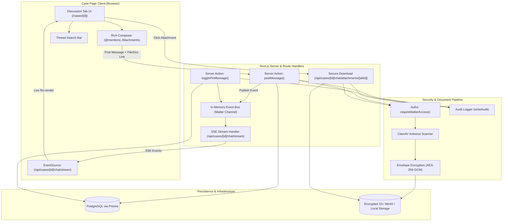

# UCAA Legal — Per-Case Chat & Collaboration System Plan
**Feature:** Per-Case Discussion Thread, Encrypted Attachments, @Mentions, Pinning & Real-Time Sync  
**Reference Document:** `docs/design/case-page.html` · `PROJECT_SPEC.md` (§5.7 tab 5, §5.9, §9, §10, §11, §12 Phase 9) · `FLOWS.md`  
**Target Path:** `docs/case-chat-plan.md`  
**Status:** Approved for Implementation  

---

## 1. Executive Summary & Objective

In the UCAA Legal Case & Matter Management System, legal officers and counsel collaborate on sensitive litigation, arbitration, regulatory enforcement, and advisory matters. Currently, the case page features a minimal text-only discussion prototype (`DiscussionTab`), while file sharing and rich collaboration remain fragmented.

This plan details the full implementation of the **Per-Case Chat & Collaboration System** (Phase 9 of the system architecture). The chat is strictly scoped **per case** (matter) and provides:
1. **Encrypted File Attachments & Dual Document Linking**: Direct file uploads protected by AES-256-GCM envelope encryption and ClamAV scanning, plus seamless linking of existing case documents from the case's Documents tab.
2. **Interactive @Mentions & Notifications**: Autocomplete tagging of case team members and department lawyers, triggering in-app bell alerts and notification emails.
3. **Message Pinning to "Case in 30 Seconds"**: Marking key strategic updates or approvals to display prominently on the catch-up summary card.
4. **Instant Real-Time Updates via Server-Sent Events (SSE)**: Live message and attachment streaming without manual page refresh.
5. **In-Thread Message & Attachment Search**: Instant filtering and navigation through the case discussion history.
6. **Strict Legal Compliance & Auditing**: Non-destructive message handling (soft deletion), complete audit logging for every message, attachment view, and download, adhering to the Uganda Data Protection and Privacy Act, 2019.

---

## 2. Architecture & Data Flow

### 2.1 System Architecture Diagram



---

## 3. Data Model & Prisma Schema Changes

The data model builds upon existing `MatterMessage` and `Document` relationships in `prisma/schema.prisma`.

### 3.1 Schema Modifications

```prisma
// --- prisma/schema.prisma ---

/// Per-case discussion thread (spec §5.7 tab 5, Phase 9).
model MatterMessage {
  id          String    @id @default(cuid())
  matterId    String
  matter      Matter    @relation(fields: [matterId], references: [id], onDelete: Cascade)
  authorId    String
  author      User      @relation("MatterMessages", fields: [authorId], references: [id])
  body        String
  
  // Pinning feature: pinned messages appear on the "Case in 30 seconds" catch-up panel
  isPinned    Boolean   @default(false)
  pinnedAt    DateTime?
  pinnedById  String?
  pinnedBy    User?     @relation("MessagePinnedBy", fields: [pinnedById], references: [id])
  
  // Soft-deletion: legal platforms must never hard-delete messages (CLAUDE.md)
  deletedAt   DateTime?
  deletedById String?
  deletedBy   User?     @relation("MessageDeletedBy", fields: [deletedById], references: [id])
  
  createdAt   DateTime  @default(now())
  updatedAt   DateTime  @updatedAt

  // Relationships
  attachments MatterMessageAttachment[]
  mentions    MatterMessageMention[]

  @@index([matterId, createdAt])
  @@index([matterId, isPinned])
}

/// Attachments associated with a case message.
/// Supports dual modes:
/// 1. Direct file upload (encrypted with envelope encryption + scanned via ClamAV)
/// 2. Reference link to an existing Document already filed in the case Documents tab
model MatterMessageAttachment {
  id               String       @id @default(cuid())
  messageId        String
  message          MatterMessage @relation(fields: [messageId], references: [id], onDelete: Cascade)
  
  // File metadata
  name             String
  size             Int
  mimeType         String
  
  // For directly uploaded chat files (AES-256-GCM envelope encryption)
  storageKey       String?
  sha256           String?
  encryptedDataKey String?
  iv               String?
  authTag          String?
  scanStatus       ScanStatus   @default(CLEAN)
  scanDetail       String?

  // For attachments linked from the case's official document repository
  documentId       String?
  document         Document?    @relation(fields: [documentId], references: [id], onDelete: SetNull)

  createdAt        DateTime     @default(now())

  @@index([messageId])
  @@index([documentId])
}

/// Explicit mentions of users within a message (@LawyerName).
model MatterMessageMention {
  id        String        @id @default(cuid())
  messageId String
  message   MatterMessage @relation(fields: [messageId], references: [id], onDelete: Cascade)
  userId    String
  user      User          @relation(fields: [userId], references: [id], onDelete: Cascade)
  createdAt DateTime      @default(now())

  @@unique([messageId, userId])
  @@index([userId])
}
```

### 3.2 User Model Relations
Add corresponding back-relations on `model User`:
- `pinnedMessages MatterMessage[] @relation("MessagePinnedBy")`
- `deletedMessages MatterMessage[] @relation("MessageDeletedBy")`
- `messageMentions MatterMessageMention[]`

### 3.3 Notification Triggers
Register in `NotificationRule` (seed and rule checks):
- `CASE_MESSAGE_MENTION`: Triggered when a user is tagged with `@name` in a case thread.
- `CASE_MESSAGE`: Triggered for assigned team members when a new message is posted (opt-outable in preferences).

---

## 4. Feature Specifications

### 4.1 Dual Attachment Workflow

Legal matters require two distinct ways to handle files in chat:
1. **Direct Upload (New Files)**:
   - A lawyer drags or selects an external file into the composer.
   - Server-side validation via `uploadMessageAttachmentSchema` (25MB limit, supported MIME types).
   - Buffer scanned through `scanBuffer` (ClamAV container).
   - Envelope encrypted via `encryptFile` (AES-256-GCM master key).
   - Stored in object storage with key: `matters/[matterId]/chat/[attachmentId]/[filename]`.
   - Download/preview served exclusively through route `/api/cases/[id]/chat/attachments/[attachmentId]/download`.
2. **Link Existing Case Document**:
   - Composer includes an "Attach from Case Documents" picker modal.
   - Displays all documents already organized in the case's folders (Pleadings, Evidence, Court Orders, etc.).
   - Creating the message stores `documentId` on `MatterMessageAttachment`.
   - In chat, clicking the attachment opens the existing secure document viewer with watermarking.

### 4.2 @Mentions & Notifications

1. **Composer Suggestion Menu**:
   - Typing `@` triggers a contextual dropdown listing:
     - Case Lead Lawyer & Supporting Lawyers (pinned at top with badge).
     - Other department lawyers and Admin.
   - Keyboard navigable (Up/Down arrows, Enter/Tab to select).
   - Inserts markdown mention token: `@[User Name](user:userId)`.
2. **Backend Processing & Delivery**:
   - Message parser extracts all `user:userId` tokens.
   - Creates `MatterMessageMention` records in the transaction.
   - Dispatches notifications via `notify({ userId, type: "CASE_MESSAGE_MENTION", ... })`.
   - Generates in-app notification bell item + notification email linking directly to `/cases/[matterId]?tab=discussion#msg-[messageId]`.

### 4.3 Message Pinning & "Case in 30 Seconds" Integration

1. **Pinning Controls**:
   - Authorized users (Lead Lawyer, Supporting Lawyer, Admin) can click a pin icon (`Pin` from `lucide-react`) on any message.
   - Toggles `isPinned` state, updates `pinnedAt` and `pinnedById`, and writes an `AuditLog` row (`message.pin` / `message.unpin`).
2. **Pinned Banner in Discussion Tab**:
   - A collapsible header bar inside the Discussion tab shows all currently pinned messages for quick reference.
3. **Synchronization with Catch-Up Panel (`catch-up-panel.tsx`)**:
   - The "Case in 30 seconds" card currently displays a static pinned placeholder from `docs/design/case-page.html`:
     ```html
     <div class="pinned">
       <svg ...><path d="M12 17v5M5 17h14l-2-4V4H7v9z"/></svg>
       <div>[Pinned message body]<small>Pinned from discussion · [Author Name] · [Date]</small></div>
     </div>
     ```
   - The panel is upgraded to render the most recent active pinned message from the database, updating automatically.

### 4.4 Real-Time Synchronization via Server-Sent Events (SSE)

1. **API Endpoint**: `GET /api/cases/[id]/chat/stream`
   - Validates session and checks `requireMatterAccess(matterId)`.
   - Sets headers:
     ```http
     Content-Type: text/event-stream
     Cache-Control: no-cache, no-transform
     Connection: keep-alive
     ```
   - Subscribes the connection to an in-process matter event channel (`chatEmitter.on(`matter:${matterId}`)`).
   - Dispatches heartbeat pings every 20 seconds (`: ping\n\n`) to prevent connection termination by proxies/browsers.
2. **Event Types Broadcast**:
   - `message.created`: New message with author, attachments, and mentions.
   - `message.pinned`: Pin status change.
   - `message.deleted`: Soft-deletion of a message.
3. **Client-Side Reconnection**:
   - React hook `useCaseChatStream(matterId)` handles automatic reconnection with exponential backoff if disconnected.
   - Merges incoming messages optimistically into the UI state.

### 4.5 In-Thread Search & Filter

1. **Search Header**:
   - A search bar integrated above the message list with a keyboard shortcut hint (`Ctrl + F` / `⌘F` within tab).
2. **Instant Filtering**:
   - Filters messages client-side by text content, author name, or attachment file names.
   - Highlights matching substrings.
   - Displays match count (e.g., `3 matches`) with Next/Previous navigation buttons.

---

## 5. UI/UX & Design Token Compliance

All components strictly comply with the design tokens specified in `PROJECT_SPEC.md §10` and `CLAUDE.md`:
- **Backgrounds**: Surfaces use `--surface` (`#FFFFFF`), with hovered rows on `--surface-muted` (`#F1EFEB`).
- **Primary Color**: Accents and user chat bubbles use `--primary` (`#4169E1`), hover `--primary-hover` (`#3759BF`), soft tint `--primary-soft` (`#E8EDFC`).
- **Avatars**: Generated using the official `--avatar-1`, `--avatar-2`, `--avatar-3` color cycle.
- **Corner Radii**: Cards use `rounded-card` (16px), buttons and inputs use `rounded-control` (10px), chips use `rounded-full`.
- **Typography**: Inter for all chat interface text; timestamps in tabular figures (`font-variant-numeric: tabular-nums`) formatted for the `Africa/Kampala` timezone.
- **Icons**: Exclusively `lucide-react` icons: `Send`, `Paperclip`, `Pin`, `PinOff`, `Search`, `FileText`, `ExternalLink`, `Download`, `Trash2`, `Smile`.

---

## 6. Security, Permissions & Compliance

1. **Role-Based Permissions**:
   | Action | Lead Lawyer | Supporting Lawyer | Other Lawyers | Admin |
   |---|:---:|:---:|:---:|:---:|
   | View case messages & attachments | Yes | Yes | Yes | Yes |
   | Post message & upload attachments | Yes | Yes | Yes | Yes |
   | Link existing case document | Yes | Yes | Yes | Yes |
   | Pin/Unpin message | Yes | Yes | No | Yes |
   | Soft-delete own message | Yes | Yes | Yes | Yes |
   | Soft-delete any message | Yes (on matter) | No | No | Yes |

2. **Audit Logging (`writeAudit`)**:
   Every mutation creates an immutable audit record:
   - `message.post`: records `matterId`, `messageId`, attachment count.
   - `message.pin` / `message.unpin`: records user and message ID.
   - `message.delete`: records soft-delete actor and reason.
   - `message.attachment.download`: records who viewed/downloaded each attachment.

3. **Confidentiality & Virus Scans**:
   - Files failing ClamAV scanning are rejected immediately with an audit log entry (`document.upload.infected`).
   - Ciphertext at rest uses individual random 256-bit data keys wrapped by the server master encryption key.

---

## 7. File Creation & Modification Plan

```
d:\Dev\client\active\civil-aviation\
├── prisma\
│   └── schema.prisma                                     [MODIFY: Add MatterMessageAttachment, Mention, Pin fields]
├── src\
│   ├── lib\
│   │   ├── validation\
│   │   │   └── case-chat.ts                              [CREATE: Zod schemas for post, pin, attach, search]
│   │   ├── chat\
│   │   │   ├── event-bus.ts                              [CREATE: Server-side SSE event emitter for chat]
│   │   │   └── attachment-storage.ts                     [CREATE: Encryption & storage helpers for chat files]
│   ├── app\
│   │   ├── api\
│   │   │   └── cases\
│   │   │       └── [id]\
│   │   │           └── chat\
│   │   │               ├── stream\
│   │   │               │   └── route.ts                  [CREATE: SSE endpoint for live updates]
│   │   │               └── attachments\
│   │   │                   └── [attachmentId]\
│   │   │                       └── download\
│   │   │                           └── route.ts          [CREATE: Secure permission-checked download route]
│   │   └── (app)\
│   │       └── cases\
│   │           └── [id]\
│   │               ├── catch-up-panel.tsx                [MODIFY: Connect pinned message from discussion]
│   │               ├── page.tsx                          [MODIFY: Fetch attachments, pins, team members]
│   │               └── tabs\
│   │                   ├── discussion-actions.ts         [MODIFY: Actions for post, upload, pin, delete]
│   │                   ├── discussion-tab.tsx            [MODIFY: Upgraded UI with SSE, attachments, search]
│   │                   ├── attach-document-dialog.tsx    [CREATE: Dialog to pick existing case documents]
│   │                   └── mention-popover.tsx           [CREATE: Autocomplete dropdown for @mentions]
```

---

## 8. Implementation Steps & Verification Checklist

### Step 1: Database Schema & Migration
1. Update `prisma/schema.prisma` with `MatterMessageAttachment`, `MatterMessageMention`, and pinning/soft-delete fields.
2. Run `npx prisma db push` or create a migration.
3. Update `prisma/seed.ts` with realistic seeded messages containing attachments, mentions, and a pinned message.

### Step 2: Backend Actions & Security Validation
1. Create `src/lib/validation/case-chat.ts` with strict Zod validation schemas.
2. Update `discussion-actions.ts` with:
   - `postCaseMessage(formData)`: supports text, multiple file uploads, and document link IDs.
   - `togglePinCaseMessage({ matterId, messageId })`.
   - `deleteCaseMessage({ matterId, messageId })`.
3. Create `src/lib/chat/event-bus.ts` and `src/app/api/cases/[id]/chat/stream/route.ts` for SSE delivery.
4. Implement secure download route `src/app/api/cases/[id]/chat/attachments/[attachmentId]/download/route.ts`.

### Step 3: Frontend Discussion Tab & Components
1. Build `useCaseChatStream(matterId)` hook for real-time reactivity.
2. Create `AttachDocumentDialog` allowing lawyers to browse and attach existing case files.
3. Implement `@mention` suggestion popover inside the composer.
4. Add attachment previews (file badge, file size, icon, download/view triggers).
5. Add pinning actions and a pinned message banner.
6. Add in-thread search bar with match counter and navigation.

### Step 4: Catch-Up Panel Synchronization
1. Update `src/app/(app)/cases/[id]/catch-up-panel.tsx` to read the real pinned message.
2. Ensure unpinning or pinning immediately reflects in both the discussion tab and the "Case in 30 seconds" card.

### Step 5: Verification & Quality Assurance
1. **Type Checking & Linting**: Run `npm run typecheck` and `npm run lint`.
2. **Functional Tests**:
   - Verify post message with text only.
   - Verify upload of PDF/DOCX/image attachment (virus scan + encryption + download).
   - Verify linking of existing case document.
   - Verify @mention triggers notification for tagged lawyer.
   - Verify pinning message updates the "Case in 30 seconds" banner.
   - Verify real-time message appearance in a second browser window via SSE.
   - Verify thread search matches text and attachments.
3. **Documentation**: Update `CHANGELOG.md` upon completion.
